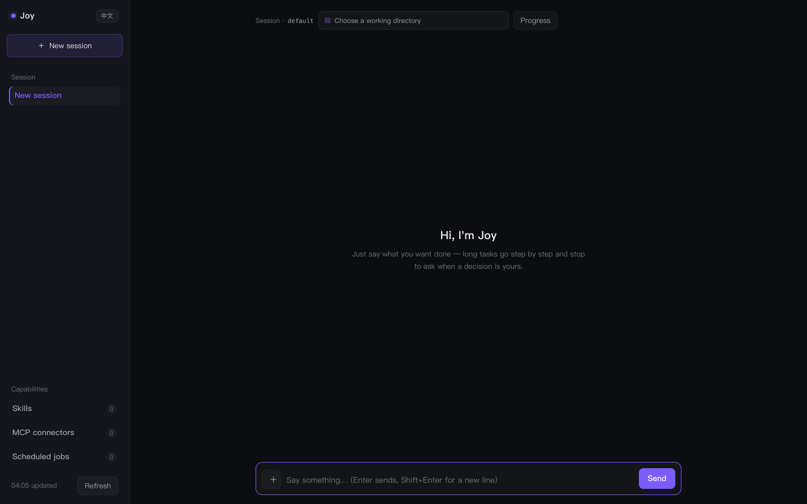
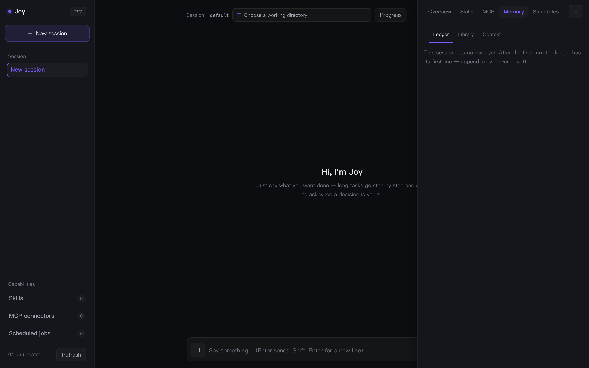

English | [简体中文](README.zh.md)

# Joy — a local agent whose memory you can open

[](https://github.com/ChrisVip001/joyczl-agent/actions/workflows/ci.yml)
[](LICENSE)
[](https://github.com/ChrisVip001/joyczl-agent/stargazers)
[](https://github.com/ChrisVip001/joyczl-agent/releases/latest)

**A personal assistant that runs entirely on your own machine — with a memory you can actually inspect.**
The focus is planning, executing, recovering, verifying and delivering complex personal tasks; everyday conversation is supporting interaction.
Rust owns the agent loop, memory and 29 tools; TypeScript is only the dashboard and the chat gateways. Conversations, `state.db` and API keys never leave your laptop. The dashboard speaks both English and Chinese — switch it from the sidebar.

> Most agents keep memory in a black box. Joy writes **one append-only ledger row per turn**. Open any row and you see that turn's full entry stream: the retrieval decision, which tools ran, which model answered, and what it cost. The memory library links back to source turns via `ledger:…` chips, and the FTS5 index can be rebuilt from the ledger. Nothing is hidden, nothing is silently lost.




## Run it in two minutes

**Prebuilt binary — no Rust toolchain needed** (pick the right asset for your platform from [Releases](https://github.com/ChrisVip001/joyczl-agent/releases/latest)):

```bash
curl -fL -o joy.tar.gz https://github.com/ChrisVip001/joyczl-agent/releases/download/v0.17.0/joy-v0.17.0-aarch64-apple-darwin.tar.gz
tar -xzf joy.tar.gz && chmod +x joy
DEEPSEEK_API_KEY=… ./joy dashboard        # -> http://localhost:7777
```

Assets: `aarch64-apple-darwin` · `x86_64-apple-darwin` · `x86_64-unknown-linux-gnu` · `aarch64-unknown-linux-gnu`.
No API key? Ollama works fully offline (`JOY_PROVIDER=ollama`). Twelve providers are pre-adapted, and `/model add` adds one without a restart.

**Docker:**

```bash
docker build -t joy .
docker run --rm -p 7777:7777 -v joy-state:/home/joy/.joy -e DEEPSEEK_API_KEY=… joy
```

**From source:**

```bash
cd joy-rs && cargo build
JOY_PROVIDER=deepseek DEEPSEEK_API_KEY=… ./target/debug/joy            # terminal REPL
JOY_PROVIDER=deepseek DEEPSEEK_API_KEY=… ./target/debug/joy dashboard  # -> localhost:7777
```

A turn over the raw protocol:

```bash
ANTHROPIC_API_KEY=sk-… JOY_HOME=/tmp/joy-demo ./target/debug/joy app-server <<'JSONRPC'
{"jsonrpc":"2.0","id":1,"method":"turn/start","params":{"message":"Remember that Alex likes morning meetings"}}
JSONRPC
```

The response follows a notification stream: `turnStarted → gateDecided → textDelta* → toolStarted → toolCompleted* → turnCompleted`. `turnCompleted.meta` records the gate ruling, tool timing, which model answered, and token usage — persisted with the conversation.

## Why it is built this way

| | Joy | Hosted assistant | Minimal agent framework |
|---|---|---|---|
| State | Local SQLite + FTS5, one process owns `state.db` | Vendor cloud | You build it |
| Memory | Append-only ledger, inspectable, rebuildable | Opaque | DIY |
| Contract | 45 JSON-RPC methods from one generated definition | N/A | Varies |
| Providers | 12 pre-adapted + models.dev catalog + Ollama | Fixed | DIY |
| Release gate | Deterministic replay evals + judge | N/A | DIY |
| Cost control | Stable prompt prefix for caching, deferred tool loading | N/A | DIY |

## What's open, and how to help

P0–P20 of the original roadmap are done. What remains is the real-world work I'd like help with: real-platform gateway integrations, Windows write boundaries, more eval cases, and docs/screenshots. Start with the [good first issue](https://github.com/ChrisVip001/joyczl-agent/issues?q=is%3Aissue+is%3Aopen+label%3A%22good+first+issue%22) list — each one has acceptance criteria. See [CONTRIBUTING.md](CONTRIBUTING.md) and [docs/limitations.md](docs/limitations.md) for known boundaries.

Releases ship every 1–2 weeks with real notes. If you want those without the noise, **Watch → Custom → Releases**.

## What Joy can do

- **Converse** on the terminal, in the dashboard, or through chat gateways
  (Telegram, Discord, WeChat, Lark — see [docs/gateways.md](docs/gateways.md))
- **Remember**: semantic facts (FTS5, CJK-capable), dated episodes, and
  procedural Skills — with a retrieval gate so memory is consulted only when
  relevant ([docs/architecture.md](docs/architecture.md))
- **Show its memory**: the drawer's **记忆** tab opens the append-only ledger (one row per
  turn; open it for that turn's entry stream), the memory library (catalog, one page at a
  time, and `ledger:…` chips back to the source turns), and the context meter (six
  sections, with a notice before the window fills). One button compacts on demand
  ([docs/operations.md](docs/operations.md))
- **Act**: 34 built-in tools (23 always on, 11 behind switches) plus MCP servers
  ([docs/configuration.md](docs/configuration.md))
- **Stay cheap**: the system prompt is a stable prefix plus a per-turn tail, so the
  provider can cache it; the skill catalog is one line per skill with bodies on demand, and
  `JOY_TOOL_POLICY=deferred` keeps only the always-on tool schemas in the request
  ([docs/configuration.md](docs/configuration.md))
- **Grow itself, on your say-so**: the dashboard's capability center lists Skills, MCP
  connectors and **scheduled jobs** side by side — add your own, delete your own; what
  ships with the install, and the jobs a skill declares, are greyed out and read-only
  ([docs/skills.md](docs/skills.md), [docs/operations.md](docs/operations.md))
- **Plan as a graph**: the triage front door answers small talk cheaply; the
  gather workflow writes a morning brief
  ([docs/architecture.md](docs/architecture.md))
- **Follow the project's own rules**: `AGENTS.md` / `AGENTS.override.md` / `CLAUDE.md` are
  discovered upwards from the working directory, joined root-first into the per-turn tail
  (32KB budget, outermost dropped first) with their source paths named
  ([docs/internals/09-app-server.md](docs/internals/09-app-server.md))
- **Never hand back half-finished work**: when the step budget runs out it reads the todo list it
  wrote itself — if items are open it keeps going (carrying the steps so far, not starting over),
  up to `JOY_AUTO_CONTINUE_MAX` continuations, then says plainly what is left
  ([docs/configuration.md](docs/configuration.md))
- **Be examined**: deterministic evals gate every release; `joy eval --replay` pins the event
  order of compaction, approval timeouts, streamed output, MCP reconnects and step-budget
  continuations; a judge grades answer quality and rejects invalid scores before averaging
  ([docs/testing.md](docs/testing.md))
- **Be observed**: every turn lands a trace line and a usage row
  ([docs/architecture.md](docs/architecture.md))

### Built-in tools

| Tool | Purpose |
|---|---|
| `save_note` / `forget_note` / `search_memory` / `list_memory` / `manage_memory` | memory CRUD |
| `create_event` / `list_events` | calendar (idempotent, ICS + optional Apple Calendar sync) |
| `send_message` | message drafts into the outbox — never actually sends |
| `search_web` | DuckDuckGo HTML, or Tavily with `TAVILY_API_KEY` |
| `read_file` | read a text file: paginated (2000 lines / 50KB, never mid-line), line numbers, a continuation protocol, and a re-read short-circuit; **on by default** |
| `list_dir` | list a directory: directories first, files with sizes, 500-entry cap; **on by default** |
| `glob` | find files by name pattern (`**` across directories, `*`/`?` inside one; a pattern with no `/` matches the file name at any depth), skipping `.git`, `node_modules`, `target`, `dist`, `build` and friends; **on by default** |
| `grep` | search file contents and return `path:line: text` (plain text, optional `ignore_case` and a `glob` filter), skipping the same trees plus binaries and anything over 2 MB, capped at 200 matches; **on by default** |
| `fetch_url` | fetch a page's text (HTML→plain, 50k cap); SSRF guard (blocks private/metadata targets, re-checks every redirect) + an external-content-is-data declaration |
| `create_skill` | persist an agreed workflow as procedural memory |
| `job_output` / `job_list` / `job_kill` | read, list and stop background jobs (started with `run_command`'s `background=true`) |
| `todo_write` | keep a per-session todo list, re-injected every turn (whole-table replace; one `in_progress` at a time) |
| `current_time` | local time with weekday and timezone |
| `write_file` / `edit` | write a text file / one exact-match replacement with a change hunk — off unless `JOY_WRITE=1`; writable boundary = the working directory **bound to the session** (or named for this turn when the session has none) + `JOY_EXEC_WRITABLE_ROOTS` |
| `apply_patch` | apply a patch: several files and several hunks in one call, **all or nothing** (one hunk that does not fit means nothing is written); same boundary and approval as `write_file` / `edit` |
| `define_tool` | define a new tool for itself: a JSON file (name, description, argument schema, command template) that lands in `<home>/tools/` and is in the table **from the next turn** — no restart, no rebuild. It runs through the same sandbox, allowlist and approval as `run_command`; off unless `JOY_EXEC=1` |
| `delete_file` | delete one file (never a directory) — same boundary and approval as `write_file`; off unless `JOY_WRITE=1` |
| `move_file` | move or rename one file, **both** ends inside the boundary, an existing destination refused — off unless `JOY_WRITE=1` |
| `run_command` | shell commands — sandboxed, allowlisted, off unless `JOY_EXEC=1` ([SECURITY.md](SECURITY.md)) |
| `delegate_task` | hand one self-contained job to a subagent (`tasks: [...]` fans out up to 4 independent jobs concurrently, merged in order) — off unless `JOY_DELEGATE=1`, cannot delegate again; pass `result_schema` for a structured answer (retried once, then prose) |
| `read_skill` | read one skill's full body — the always-present catalog carries only its name and one line; **on by default** |
| `read_memory_page` | read one page of the memory bundle by name, with the `sources` it was distilled from; **on by default** |
| `find_tools` | search the deferred shelf by keyword and open what it finds for **this session** (`JOY_TOOL_POLICY=deferred`); **on by default** |
| `schedule_job` | create or replace a scheduled job in `<home>/schedules.json` — name, five-field cron, one prompt; **on by default** |
| `list_schedules` | every declared job with its cron and prompt (skill-declared ones included); **on by default** |
| `cancel_schedule` | delete a file-declared job by name — a skill's job is refused with the way out; **on by default** |

### Providers and keys

**Twelve LLM providers are pre-adapted in code** (`joyczl-provider`), switchable at will — and extendable without code: `<home>/models-catalog.json` patches built-in defaults or adds a provider, and `scripts/gen_catalog.py` generates those rows from [models.dev](https://models.dev) (context limits, vision, tool-call — joy's wire and key-env mappings included). See [docs/configuration.md](docs/configuration.md). `/model` lists configured profiles, `/model add ds deepseek deepseek-flash --env DEEPSEEK_API_KEY` adds one, `/model use ds` switches — no need to retype the key, effective immediately, no restart. Configuration lives in the REPL's `/model` and `models.json` — the dashboard carries no config panel. Keys go to the OS keychain first (macOS Keychain, Linux `secret-tool`, **Windows Credential Manager**), falling back to `<home>/secrets.json` (0600, plaintext) when there is none — the save response says which one it was, honestly. Key writes go through the `SecretVault` seam, so a server-side KMS backend can slot in without touching callers. **The old `JOY_API_KEY` / `JOY_BASE_URL` env vars are no longer read** — configuration has exactly one path: `models.json`. The dashboard also self-hosts: `JOY_OPS_HOST=0.0.0.0` demands `JOY_OPS_TOKEN` at startup, `/api/*` is Bearer-gated ([docs/operations.md](docs/operations.md)).

Tool failures return to the model as text — the loop never crashes on one.

## Documentation

| Document | Content |
|---|---|
| [docs/architecture.md](docs/architecture.md) | principles, crate dependency graph, one turn's data flow, key mechanisms, design decisions |
| [docs/protocol.md](docs/protocol.md) | the 45 JSON-RPC methods, notification sequence, error codes, clients |
| [docs/configuration.md](docs/configuration.md) | every `JOY_*` variable, gateway variables, mcp.json, settings.json |
| [docs/gateways.md](docs/gateways.md) | Telegram / Discord / WeChat / Lark setup, quirks, and security notes |
| [docs/testing.md](docs/testing.md) | the four-layer quality system and the latest test report |
| [docs/operations.md](docs/operations.md) | running every shape, backups, troubleshooting |
| [docs/limitations.md](docs/limitations.md) | every known boundary — deliberate or not — with the file to open next |
| [docs/internals/](docs/internals/README.md) | the tutorial: every crate's algorithms, data flow and invariants, chapter by chapter |
| [docs/skills.md](docs/skills.md) | skill authoring: format, triggers, install and export |
| [CONTRIBUTING.md](CONTRIBUTING.md) | engineering discipline and commit rules |
| [SECURITY.md](SECURITY.md) | the security model: credentials, capability boundaries, OAuth |
| [CHANGELOG.md](CHANGELOG.md) | changelog |

## Roadmap

**Next up (help wanted):** real-platform gateway integrations · Windows writable-boundary support · more replay eval cases · provider coverage beyond the 12 built in · Homebrew / npm packaging channels. See [open issues](https://github.com/ChrisVip001/joyczl-agent/issues) for the concrete list.

<details>
<summary>Shipped: phases P0–P20 (click to expand)</summary>

| Phase | Content |
|---|---|
| P0 ✅ | protocol layer + generation pipeline (63 types) |
| P1 ✅ | state (SQLite+FTS5), app-server (JSON-RPC over stdio), `joy` CLI |
| P2 ✅ | config / provider (12, incl. Ollama) / tools / loop / memory (gate + consolidation) |
| P2b ✅ | provider streaming, MCP, graph + triage front door |
| P3 ✅ | dashboard, Telegram / Discord / WeChat / Lark gateways (the latter three never connected to real platforms) |
| P4 ✅ | terminal REPL, turn/interrupt, config/write + model/list, full tool set, Skills, trace/usage, gather, MCP OAuth, evals + gate + judge |
| P5 ✅ | local inference (Ollama, no key), `joy mcp serve` (memory as an MCP server), Homebrew formula + Dockerfile |
| P6 ✅ | sandboxed execution behind `JOY_EXEC` (deny list + allowlist + seatbelt/bwrap), context compaction (rolling summaries), declarative schedules (`joy schedule`) |
| P7 ✅ | hybrid retrieval (`JOY_EMBEDDINGS`, RRF), temporary-statement filter, skill updates (`joy skill update`) |
| P8 ✅ | startup config validation, tool-argument schema checks, a stall guard, token budgets, sandboxed-and-offline execution, visible retries, output spilling, subagents, interactive approval, skill policy fields, memory kinds |
| P9 ✅ | tool-result budgets (line-aware spilling + observed-prefill calibration), subagent report scanning and `result_schema`, MCP circuit breaking and name de-duplication, memory write de-duplication, twelve lifecycle hooks (`JOY_HOOKS`), a todo list, background jobs, and a goal loop (`/goal`) |
| P10 ✅ | file-writing tools (`write_file`/`edit`), image input, model catalog, HTTP hooks, declarative workflows, per-session write lock, Windows boundary (Unix-only), distribution materials (npm shim / brew / release workflow) |
| P11 ✅ | accounts & multi-device: register/login hub (PBKDF2, per-device tokens, seat cap), dashboard remote mode + login card, cross-device event sync, CORS, PWA skeleton, Tauri desktop shell |
| P12 ✅ | long-task engine (turn-level checkpoints): working memory persisted at tool boundaries, kill -9 → startup reconcile auto-resumes (finished tools never re-run), `task_*` event pings, dashboard resume notice |
| P13 ✅ | long tasks as entities (`agent_tasks`): the goal loop becomes their engine, one active task per session, create/pause/resume/cancel, a pause keeps the checkpoint (resume continues it), boot reconcile marks suspended, dashboard task-card switches |
| P14 ✅ | connectors (M4): email (SMTP) and Feishu (app identity) — allowlist hard boundary, drafts by default, one approval per live send; `joy connector` for humans; read-only dashboard panel |
| P15 ✅ | business form (M5): task API (`POST /api/run`, one turn in, one JSON answer out), inbound webhooks (`webhooks.json` + `X-Joy-Secret`, no config = no door), tier routing (a task or a caller declares `tier` and it wins even in fixed mode; the table lives in `model-routes.json` / REPL `/route`) |
| P16 ✅ | task entities (0.14): done decided by facts — three deterministic acceptance checks before the judge, task-level budgets, runs / steps / events / artifacts, idempotency that blocks but never replays, long-task benchmarks with a recovery rate, an optional execution plan (`JOY_PLAN`) |
| P17 ✅ | session metadata (0.15): the `sessions` table (migration 0018), `session/get` / `session/update` / `turn/list`, the working directory follows the session |
| P18 ✅ | session gate (0.16): one turn per session at a time (`SESSION_BUSY`), `turn/steer` for a running turn, `turn/follow-up` to queue the next one (migration 0019, survives a restart), the `turnSteered` notification |
| P19 ✅ | secrets & productization: Windows Credential Manager + the `SecretVault` seam, self-hosting security (non-loopback demands `JOY_OPS_TOKEN`), the models.dev catalog generator (`scripts/gen_catalog.py`), dashboard streams Markdown block-incrementally, a one-line session sidebar with a draggable edge and hover marquee |
| P20 ✅ | memory & context (0.17): the append-only ledger (a digest per row, oversized payloads spooled under `ledger/`, turns rebuilt from rows), the OKF bundle in `<home>/memory` with a rebuildable FTS5 index, a background worker that consolidates and mirrors (claim-first, one flight, backoff), the dashboard's memory center (ledger / library / meter), a split system prompt with an Anthropic cache breakpoint and cached-token accounting, thin/full souls, a skill catalog with on-demand bodies (`read_skill`), deferred tool loading (`find_tools`), oldest-first result trimming, and `/compact [focus]` |

</details>

## Naming

| Purpose | Name |
|---|---|
| Repo / crates.io | `joyczl-agent` |
| Rust crate prefix | `joyczl-` |
| CLI binary | `joy` |
| Persona | Joy |
| Env vars | `JOY_*` |
| State directory | `.joy/` |


<details>
<summary>Design principles (expanded)</summary>

## Design principles

1. **Rust owns logic and state.** The agent loop, memory, tools, and
   state.db live in Rust; crates are split by responsibility (target <500
   lines per module), with no `joy-core` mega-crate.
2. **The protocol has one definition.** `joyczl-protocol` is the single
   source of truth for the cross-language contract: types generate the
   TypeScript bindings, and the artifacts are checked in.
3. **Clients only translate.** The CLI, dashboard and chat gateways are all
   clients of `joy app-server` (JSON-RPC over stdio); state.db is
   owned by the app-server runtime. Independently started runtimes still lack
   cross-process turn coordination; see the runtime limits.

</details>


## Runtime reliability

Production entry points share one execution owner per canonical state database. Competing runtimes fail before recovery can alter live work. See [runtime ownership](docs/limitations.md#long-running-and-the-daemon-lock).

File acceptance now records the measured content digest in a versioned receipt. The checks and receipt commit together; evidence failures stop completion. See [verification evidence](docs/protocol.md#versioned-verification-evidence).

Unknown task operations can be inspected and reconciled with human evidence in the cockpit. Reconciliation records a receipt without rerunning tools or resuming work; original acceptance remains required. See [operation protocol](docs/protocol.md#operation-journal-and-human-reconciliation).

Tasks can also retain a draft while waiting for one human-declared external input. The cockpit supports declaring the condition and providing data; persisted events survive restart, while human pause/cancel retains priority. See [external input protocol](docs/protocol.md#durable-external-input).

Tasks recheck acceptance after recovery. Known checkpoint tokens remain charged when recovery stops for review or lacks model configuration; repeated recovery does not charge them twice. `just smoke-recovery` tests real process crashes with isolated local fixtures. Authorized tasks can wait durably for background jobs and resume after known completion; human pause/cancel takes precedence. Tool batches and background jobs persist intent before execution; unknown outcomes require reconciliation. Queued instructions remain recorded until completion. Generated memory views refresh after content corrections or new episodes and retry failed writes; existing memory can project without a configured model. Consolidation can retain source-bound temporary observations for up to 24 hours ([memory contract](docs/protocol.md#memory-validity-and-derivation-context)). Quick chat retains recent session context, SOUL and bounded saved personal preferences; skill discovery supports Chinese descriptions. OpenAI uses the native Responses adapter with local encrypted continuation; see [configuration](docs/configuration.md#native-openai-responses) for legacy-endpoint overrides. See [recovery boundaries and limits](docs/limitations.md#crash-recovery) before relying on unattended work. Plans restore complete versions after restart. A [budgeted live smoke](docs/live-reliability.md) records the current DeepSeek profile, evidence and costs.

Click **Start task** to authorize durable queued work in its own session while continuing the original chat. See [independent task execution](docs/protocol.md#independent-task-execution).

Task/goal stop status and notification production commit together. Failed commits cannot advertise completion; failed delivery is retained for retry against the original destination.

Scheduled results and delivery intent persist together; file failures retry delivery. Unknown claimed work requires review and is not replayed. See [schedule recovery](docs/operations.md#schedule-recovery-and-delivery).

Human memory deletion/correction now prevents matching old claims from being re-extracted automatically; forgotten subjects stay excluded from background extraction. Explicit memory writes remain available. See [memory boundaries](docs/limitations.md#memory).

Stored constraints are strictly validated before planning and model calls. Recovery retains its checkpoint round number, charges known checkpoint usage once, and checks the remaining budget before proceeding.

English | [简体中文](README.zh.md) · Code is MIT.

Human memory validity windows and extraction context are documented in [the memory protocol](docs/protocol.md#memory-validity-and-derivation-context).

Mutating tools now coordinate across sessions and retain ownership for background jobs; see [mutation admission](docs/architecture.md#mutation-admission).

Structured artifact checks now verify typed JSON values and retain file-version evidence; see [structured document acceptance](docs/protocol.md#structured-document-acceptance).

Ordinary chats now have [human operation review](docs/protocol.md#ordinary-chat-operation-review), with read-only continuation while earlier outcomes remain unknown.

When a full agent turn's tool table is empty, its capability note asks for plain text and disclosure of verification limits. This is guidance, not an output guarantee; see the [live support evidence and limits](docs/live-reliability.md).

Full, delegated and quick replies now share memory-grounding and companionship instructions: distinguish current references from recalled history and avoid continuous-availability or guaranteed-recall promises. User `SOUL.md` stays intact; compliance still needs [live evaluation](docs/live-reliability.md).

If required task step or artifact observations cannot be persisted, known usage is retained and acceptance/automatic continuation stop for review of work already performed. Existing files or external effects are not rolled back.
