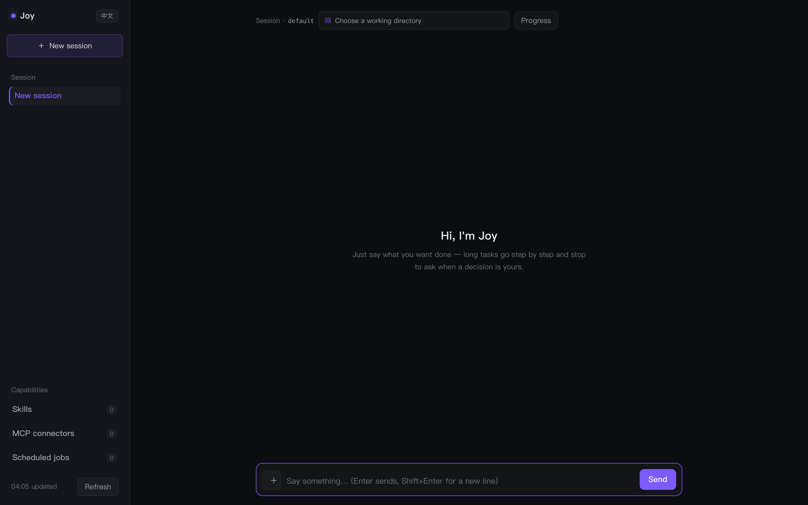
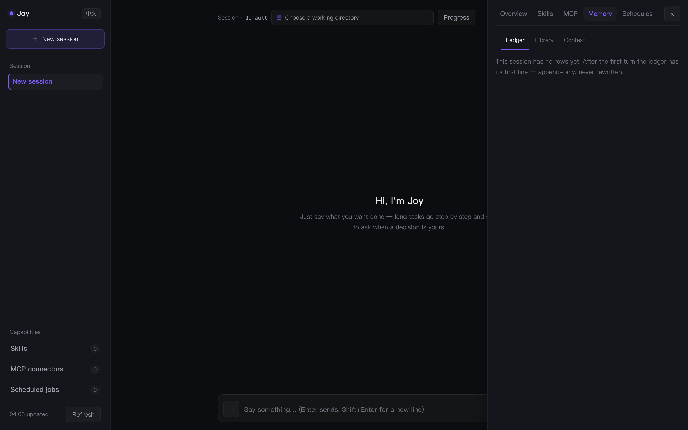

[English](README.md) | 简体中文

# Joy — 记忆能翻开的本地 Agent

[](https://github.com/ChrisVip001/joyczl-agent/actions/workflows/ci.yml)
[](LICENSE)
[](https://github.com/ChrisVip001/joyczl-agent/stargazers)
[](https://github.com/ChrisVip001/joyczl-agent/releases/latest)

**一个完全跑在自己机器上的个人助手，而且它的记忆是能打开看的。**
Rust 独占 agent 循环、记忆和 29 个工具；TypeScript 只负责驾驶舱和聊天网关；Python 留一个薄 SDK。对话、`state.db` 和密钥都不出本机。驾驶舱支持中英文切换，侧栏一键换语言。

> 多数 Agent 的记忆是个黑盒。Joy **每一轮对话只追加一行账本**：点开这一行，能看到这一轮的完整事件流——检索门怎么判的、跑了哪些工具、哪个模型答的、花了多少 token。记忆库用 `ledger:…` 回溯到原始轮次，FTS5 索引能从账本重建。不藏东西，也不会悄悄丢东西。

<!-- 补图后取消注释（拍摄清单见 01-README改写.md）


-->

## 两分钟跑起来

**预编译二进制，不需要 Rust 工具链**（从 [Releases](https://github.com/ChrisVip001/joyczl-agent/releases/latest) 选自己平台的包）：

```bash
curl -fL -o joy.tar.gz https://github.com/ChrisVip001/joyczl-agent/releases/download/v0.17.0/joy-v0.17.0-aarch64-apple-darwin.tar.gz
tar -xzf joy.tar.gz && chmod +x joy
DEEPSEEK_API_KEY=… ./joy dashboard        # -> http://localhost:7777
```

四个产物：`aarch64-apple-darwin`、`x86_64-apple-darwin`、`x86_64-unknown-linux-gnu`、`aarch64-unknown-linux-gnu`。
没有 API key 也能用 Ollama 全离线跑（`JOY_PROVIDER=ollama`）。内置 12 家 provider，`/model add` 加一家不用重启。

**Docker：**

```bash
docker build -t joy .
docker run --rm -p 7777:7777 -v joy-state:/home/joy/.joy -e DEEPSEEK_API_KEY=… joy
```

**源码构建：**

```bash
cd joy-rs && cargo build
JOY_PROVIDER=deepseek DEEPSEEK_API_KEY=… ./target/debug/joy            # 终端对话
JOY_PROVIDER=deepseek DEEPSEEK_API_KEY=… ./target/debug/joy dashboard  # -> localhost:7777
```

直接打一轮原始协议：

```bash
ANTHROPIC_API_KEY=sk-… JOY_HOME=/tmp/joy-demo ./target/debug/joy app-server <<'JSONRPC'
{"jsonrpc":"2.0","id":1,"method":"turn/start","params":{"message":"记住 alex 喜欢早上的会议"}}
JSONRPC
```

应答之前先来一串通知：`turnStarted → gateDecided → textDelta* → toolStarted → toolCompleted* → turnCompleted`。`turnCompleted.meta` 记录检索门判定、工具耗时、实际作答的模型与 token 用量——随对话落库。

## 为什么这么设计

| | Joy | 云端助手 | 极简 Agent 框架 |
|---|---|---|---|
| 状态 | 本地 SQLite + FTS5，`state.db` 只由一个进程打开 | 厂商云上 | 自己搭 |
| 记忆 | 只追加账本、可检视、可重建 | 黑盒 | 自己搭 |
| 契约 | 45 个 JSON-RPC 方法，类型一处定义、多语言生成 | — | 各不相同 |
| Provider | 内置 12 家 + models.dev 目录 + Ollama | 固定 | 自己搭 |
| 发版门禁 | 确定性回放 evals + judge | — | 自己搭 |
| 成本 | 稳定前缀命中缓存、工具按需加载 | — | 自己搭 |

## 还缺什么，怎么参与

原路线图 P0–P20 已完成。剩下的是真正需要人手的活：聊天网关接真实平台、Windows 写入边界、更多 eval 用例、文档与截图。从 [good first issue](https://github.com/ChrisVip001/joyczl-agent/issues?q=is%3Aissue+is%3Aopen+label%3A%22good+first+issue%22) 开始，每条都写了验收标准。已知边界见 [docs/limitations.zh.md](docs/limitations.zh.md) 与 [CONTRIBUTING.zh.md](CONTRIBUTING.zh.md)。

每 1–2 周发一个版本并写真实变更说明。只想收版本通知的话：**Watch → Custom → Releases**。

## Joy 能做什么

- **对话**：终端、网页驾驶舱，或聊天网关（Telegram、Discord、微信、
  飞书——见 [docs/gateways.zh.md](docs/gateways.zh.md)）
- **记忆**：语义事实（FTS5、支持中文）、带日期的情景、过程 Skills——
  检索门保证只在相关时才翻记忆（[docs/architecture.zh.md](docs/architecture.zh.md)）
- **把记忆摊开给你看**：抽屉的「记忆」页能翻只追加的账本（一轮一行，点开看这一轮的
  条目流）、记忆库（目录、一次一页的正文，以及跳回来源轮次的 `ledger:…` chip）和上下文
  占用（六段分层条，快满之前先给一句提示）。想压缩就按一下，不必等它自己到点
  （[docs/operations.zh.md](docs/operations.zh.md)）
- **行动**：29 个内置工具（21 个默认常驻，8 个在开关后面）外加 MCP 服务器
  （[docs/configuration.zh.md](docs/configuration.zh.md)）
- **花得少一点**：系统提示是「稳定前缀 + 每轮尾巴」，供应商那边能缓存；技能目录一个技能
  一行、正文按需取；`JOY_TOOL_POLICY=deferred` 时请求里只放常驻工具的 schema
  （[docs/configuration.zh.md](docs/configuration.zh.md)）
- **长本事，但你说了算**：驾驶舱的「能力中心」把技能、MCP 连接器和**定时任务**并排摆着
  —— 自己的可以加、可以删；随安装分发的内置项、以及技能自带的定时任务都置灰只读
  （[docs/skills.zh.md](docs/skills.zh.md)、[docs/operations.zh.md](docs/operations.zh.md)）
- **图式规划**：triage 前门让闲聊便宜地得到快答；gather 工作流写晨报
  （[docs/architecture.zh.md](docs/architecture.zh.md)）
- **按项目规矩干活**：工作目录里往上找 `AGENTS.md` / `AGENTS.override.md` / `CLAUDE.md`，
  按「根 → 当前目录」拼进每轮尾巴（32KB 预算，超了从最外层丢），并标出来源路径
  （[docs/internals/09-app-server.md](docs/internals/09-app-server.md)）
- **不把做到一半的活扔回来**：步数用完时先看它自己写下的待办 —— 还有没做完的就接着
  做（带上刚才的步骤，不是从头再来），用满 `JOY_AUTO_CONTINUE_MAX` 次才收尾，并说清
  还剩什么（[docs/configuration.zh.md](docs/configuration.zh.md)）
- **被检验**：确定性 eval 把守每次发布；`joy eval --replay` 用录制对话钉住事件顺序
  （压缩、审批超时、增量输出、MCP 断线、步数用尽自动续片）；judge 给回答质量打分
  （[docs/testing.zh.md](docs/testing.zh.md)）
- **被观察**：每轮落一条 trace 与一行用量
  （[docs/architecture.zh.md](docs/architecture.zh.md)）

### 内置工具

| 工具 | 用途 |
|---|---|
| `save_note` / `forget_note` / `search_memory` / `list_memory` / `manage_memory` | 记忆增删改查 |
| `create_event` / `list_events` | 日程（幂等，ICS + 可选 Apple Calendar 同步） |
| `send_message` | 消息草稿进 outbox——**从不真的发送** |
| `search_web` | DuckDuckGo HTML，设 `TAVILY_API_KEY` 升级 Tavily |
| `read_file` | 读文本文件：分页（2000 行/50KB、不切半行）+ 行号 + 续读协议 + 重读短路；**默认开** |
| `list_dir` | 列目录：目录在前、文件带大小，500 项上限；**默认开** |
| `fetch_url` | 抓网页正文（HTML→纯文本，50k 封顶）；SSRF 护栏（拒内网/metadata、重定向逐跳复检）+ 外站内容「数据不是指令」声明 |
| `create_skill` | 把约定的工作流存成过程记忆 |
| `job_output` / `job_list` / `job_kill` | 读写后台作业（`run_command` 的 `background=true` 起的那些） |
| `todo_write` | 维护一张每轮重新注入的待办清单（整表替换；同时只能一项 `in_progress`） |
| `current_time` | 本地时间（含星期与时区） |
| `write_file` / `edit` | 写文本文件 / 一次精确匹配替换（返回变更 hunk）——终端与 hub 默认关，驾驶舱默认开且每次写入在对话里问一次；可写范围 = **会话绑定的工作目录** + `JOY_EXEC_WRITABLE_ROOTS`（会话没选目录时可在这一轮临时指定），没有目录一处也写不了 |
| `apply_patch` | 按补丁改文件：一次可以改多个文件、多处，**全中才落盘**（一处对不上就一处也不改）；与 `write_file` / `edit` 同一个可写范围与审批 |
| `run_command` | 执行 shell 命令——沙箱 + 放行表，默认关（`JOY_EXEC=1` 才开，见 [SECURITY.zh.md](SECURITY.zh.md)）；`background=true` 丢到后台跑 |
| `delegate_task` | 把一件自成一体的活交给子代理（`tasks: [...]` 一次最多派 4 件互不依赖的，并发跑、按顺序合并）——默认关（`JOY_DELEGATE=1` 才开），且它不能再派生；可给 `result_schema` 要结构化结论（不合规重试一次后回落散文） |
| `read_skill` | 读一个技能的完整正文——常驻的目录里只有名字与一句话；**默认开** |
| `read_memory_page` | 按名字读记忆库里的一页正文，连带它是从哪几轮提炼来的 `sources`；**默认开** |
| `find_tools` | 按关键词在延迟加载的工具里找，并把命中的工具在本会话里打开（`JOY_TOOL_POLICY=deferred`）；**默认开** |
| `schedule_job` | 在 `<home>/schedules.json` 里新建或覆盖一个定时任务：名字、五段 cron、一句话；**默认开** |
| `list_schedules` | 列出所有已声明的任务（含技能自带的那种）及其 cron 与提示词；**默认开** |
| `cancel_schedule` | 按名字删掉一个文件声明的任务 —— 随技能来的会被拒绝并说明去处；**默认开** |

### 模型与密钥

**12 家 LLM 厂商预适配在代码里**（`joyczl-provider`），模型随手切——而且不改代码也能扩：`<home>/models-catalog.json` 可以补丁内置默认值或新增一家，`scripts/gen_catalog.py` 还能从 [models.dev](https://models.dev) 直接生成这些行（context 上限、看图、工具调用都取自上游，joy 的 wire 与 key_env 映射已内置）。见 [docs/configuration.zh.md](docs/configuration.zh.md)。`/model` 看已配好的套，`/model add ds deepseek deepseek-chat --env DEEPSEEK_API_KEY` 加一套，`/model use ds` 切过去 —— 不用重发密钥，立刻生效、不用重启。模型配置在终端的 `/model` 或 `models.json` 里，驾驶舱不再摆配置面板。密钥优先进系统钥匙串（macOS 钥匙串、Linux `secret-tool`、**Windows Credential Manager**）；没有钥匙串时退回 `<home>/secrets.json`（0600 明文），保存后会如实说是哪一种。密钥写入走 `SecretVault` 接缝，服务器形态的 KMS 后端出现时只加实现、不改调用方。**旧的 `JOY_API_KEY` / `JOY_BASE_URL` 等环境变量已不再读取**——配置只有 `models.json` 这一条路。驾驶舱也能自托管：`JOY_OPS_HOST=0.0.0.0` 时启动强制要求 `JOY_OPS_TOKEN`，`/api/*` 走 Bearer 鉴权（见 [docs/operations.zh.md](docs/operations.zh.md)）。

工具失败以文本回给模型——loop 绝不因一次工具失败而崩。

## 文档

| 文档 | 内容 |
|---|---|
| [docs/architecture.zh.md](docs/architecture.zh.md) | 技术架构：原则、crate 依赖图、turn 数据流、关键机制、设计决策 |
| [docs/protocol.zh.md](docs/protocol.zh.md) | 协议参考：45 个方法、通知序列、错误码、客户端 |
| [docs/configuration.zh.md](docs/configuration.zh.md) | 配置参考：全部 `JOY_*` 变量、网关变量、mcp.json、settings.json |
| [docs/gateways.zh.md](docs/gateways.zh.md) | Telegram / Discord / 微信 / 飞书的接法、平台怪癖与安全提示 |
| [docs/testing.zh.md](docs/testing.zh.md) | 四层质量体系与最新测试报告 |
| [docs/operations.zh.md](docs/operations.zh.md) | 运行手册：各种运行形态、备份、故障排查 |
| [docs/limitations.zh.md](docs/limitations.zh.md) | 已知边界清单：刻意的与未做的，每条都指出下一步该打开哪个文件 |
| [docs/internals/](docs/internals/README.md) | 实现原理教程：逐章讲透每个 crate 的算法、数据流与不变量 |
| [docs/skills.zh.md](docs/skills.zh.md) | 技能创作：格式、触发规则、安装与分发 |
| [CONTRIBUTING.zh.md](CONTRIBUTING.zh.md) | 贡献指南：工程纪律与提交规则 |
| [SECURITY.zh.md](SECURITY.zh.md) | 安全模型：凭证、能力边界、OAuth |
| [CHANGELOG.zh.md](CHANGELOG.zh.md) | 更新日志 |

## 路线图

**接下来（欢迎认领）：** 聊天网关接真实平台 · Windows 写入边界支持 · 更多 replay eval 用例 · 扩展第 13 家之后的 provider · Homebrew / PyPI / npm 发布链路。具体条目见 [open issues](https://github.com/ChrisVip001/joyczl-agent/issues)。

<details>
<summary>已完成：P0–P20（展开）</summary>

| 阶段 | 内容 |
|---|---|
| P0 ✅ | 协议层 + 生成管线（63 个类型） |
| P1 ✅ | state（SQLite+FTS5）、app-server（JSON-RPC over stdio）、`joy` CLI |
| P2 ✅ | config / provider（12 家，含 Ollama）/ tools / loop / memory（门 + 提炼） |
| P2b ✅ | provider 流式、MCP、图 + triage 前门 |
| P3 ✅ | 驾驶舱，Telegram / Discord / 微信 / 飞书网关（后三者未连过真平台） |
| P4 ✅ | 终端 REPL、turn/interrupt、config/write + model/list、完整工具集、Skills、trace/usage、gather、MCP OAuth、evals + gate + judge |
| P5 ✅ | 本地推理（Ollama，不需要 key）、`joy mcp serve`（把记忆暴露成 MCP 服务器）、Homebrew formula + Dockerfile |
| P6 ✅ | `JOY_EXEC` 三道闸门的沙箱执行（硬拒名单 + 放行表 + seatbelt/bwrap）、上下文压缩（滚动摘要）、声明式定时任务（`joy schedule`） |
| P7 ✅ | 混合检索（`JOY_EMBEDDINGS`，RRF）、临时陈述过滤、技能更新（`joy skill update`） |
| P8 ✅ | 启动期配置校验、工具参数 schema 校验、循环护栏、token 预算、沙箱且默认断网的执行、可见的重试、超长输出落盘、子代理、交互式批准、技能策略字段、记忆类别 |
| P9 ✅ | 工具结果预算（按行落盘 + 实测 prefill 校准）、子代理报告扫描与 `result_schema`、MCP 熔断与命名去重、记忆写入去重、12 个生命周期钩子（`JOY_HOOKS`）、待办清单、后台作业、目标循环（`/goal`） |
| P10 ✅ | 文件写入工具（`write_file`/`edit`）、图片输入、模型目录、HTTP 钩子、声明式工作流、per-session 写段锁、Windows 边界（仅 Unix）、分发物料（npm shim / brew / PyPI / release workflow） |
| P11 ✅ | 账号与多端：hub 注册登录（PBKDF2、每设备 token、座位上限）、dashboard 远程模式与登录卡、跨端事件同步、CORS、PWA 骨架、Tauri 桌面壳 |
| P12 ✅ | 长任务引擎（回合级 checkpoint）：工具边界落盘工作记忆、kill -9 后启动对账自动续跑（已完成的工具不重跑）、`task_*` 事件 ping、dashboard 续跑提示 |
| P13 ✅ | 长任务实体（`agent_tasks`）：任务 → 目标循环执行器、一会话一活跃、创建/暂停/继续/取消、暂停保留断点（继续即续跑）、重启对账标挂起、dashboard 任务卡开关 |
| P14 ✅ | 连接器（M4）：email（SMTP）与飞书（应用身份）——白名单硬边界、默认草稿、每次实发一问；`joy connector` 人类入口；驾驶舱只读面板 |
| P15 ✅ | 业务形态（M5）：任务 API（`POST /api/run`，一轮进、一段 JSON 出）、入站 webhook（`webhooks.json` + `X-Joy-Secret`，没配置就没这扇门）、档位路由（任务/接口声明 `tier`，fixed 模式下也生效；档位表在 `model-routes.json` / REPL `/route`） |
| P16 ✅ | 任务实体版（0.14）：完成由事实决定 —— 验收三条确定性检查先于判断器、任务级预算、执行/步骤/事件/交付物五张表、幂等只拦不重放、长任务基准与中断恢复率、可选的执行计划（`JOY_PLAN`） |
| P17 ✅ | 会话元数据（0.15）：`sessions` 表（迁移 0018）、`session/get` / `session/update` / `turn/list`、工作目录跟着会话走 |
| P18 ✅ | 会话门（0.16）：一个会话同时只跑一轮（`SESSION_BUSY`）、`turn/steer` 运行中补充、`turn/follow-up` 排队下一轮（迁移 0019，重启不丢）、`turnSteered` 通知 |
| P19 ✅ | 密钥与产品化：Windows Credential Manager + `SecretVault` 接缝、驾驶舱自托管安全（绑非回环强制 `JOY_OPS_TOKEN`）、models.dev 目录生成器（`scripts/gen_catalog.py`）、驾驶舱流式 Markdown 块级渲染、单行会话侧栏 + 可拖边界 + 悬停跑马灯 |
| P20 ✅ | 记忆与上下文（0.17）：只追加的会话账本（逐行 digest、超限内容转存 `ledger/`、按行重建一轮）、`<home>/memory` 的 OKF bundle 与可重建的 FTS5 索引、后台整理 worker（claim-first 单飞、退避）、驾驶舱记忆中心（账本 / 记忆库 / 占用率）、拆成「稳定前缀 + 每轮尾巴」的系统提示与 Anthropic 缓存断点、cached token 记账、薄/全两档灵魂、技能目录 + 正文按需（`read_skill`）、延迟加载工具（`find_tools`）、从旧到新的结果换桩、`/compact [重点]` |

</details>

## 命名

| 用途 | 名字 |
|---|---|
| 仓库 / PyPI / crates.io | `joyczl-agent` |
| Rust crate 前缀 | `joyczl-` |
| CLI 二进制 | `joy` |
| 助手人格 | Joy |
| 环境变量 | `JOY_*` |
| 状态目录 | `.joy/` |


<details>
<summary>设计原则</summary>

## 设计原则

1. **Rust 独占逻辑与状态。** agent 循环、记忆、工具与 state.db 全在
   Rust；crate 按职责切碎（目标 <500 行/模块），不设 `joy-core` 大包。
2. **协议只有一份定义。** `joyczl-protocol` 是跨语言契约的唯一事实来源：
   类型直接生成 TypeScript 与 Python 绑定，生成物 check-in。
3. **客户端只做翻译。** CLI、dashboard、聊天网关、Python SDK 都是
   `joy app-server`（JSON-RPC over stdio）的客户端；state.db 只在一个
   进程里打开。

</details>


## 运行可靠性

任务恢复后重新验收，已授权任务可持久等待后台作业完成后继续，人工暂停或取消优先。工具批次与后台作业在执行前持久化意图，结果未知时等待核对。排队指令保留到结果落盘。快速聊天携带近期会话与 SOUL，技能发现支持中文描述。OpenAI 使用原生 Responses 并在本地保留加密接续数据，旧端点兼容方式见[配置文档](docs/configuration.zh.md#原生-openai-responses)。无人值守前请了解[恢复边界与限制](docs/limitations.zh.md)。 计划在重启后恢复完整版本。[限额真实模型评测](docs/live-reliability.zh.md)记录当前 DeepSeek 配置、证据和费用。


[English](README.md) | 简体中文 · Code is MIT.
